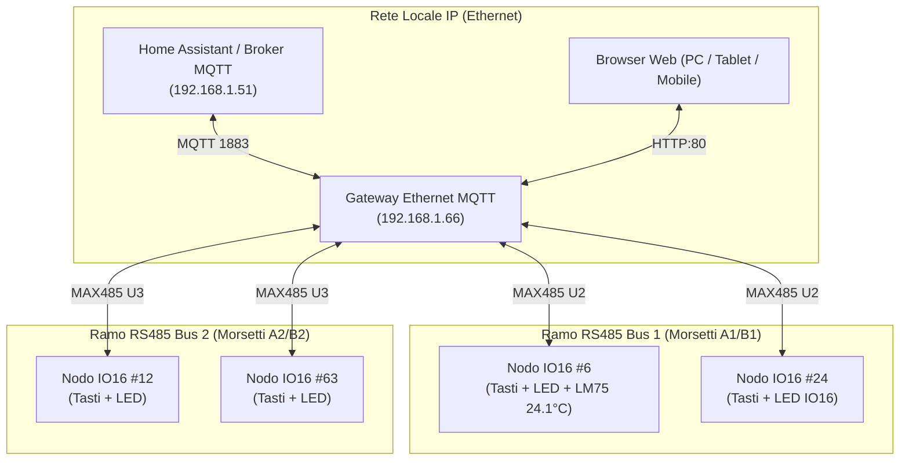

# Manuale Utente e Guida d'Installazione
## Ecosistema Domotico RS485 PJON & Gateway Ethernet MQTT

---

### Indice dei Contenuti
1. [Panoramica del Sistema](#1-panoramica-del-sistema)
2. [Dispositivo 1: Gateway Ethernet MQTT Dual Bus](#2-dispositivo-1-gateway-ethernet-mqtt-dual-bus)
   - 2.1 [Caratteristiche e Connessioni Hardware](#21-caratteristiche-e-connessioni-hardware)
   - 2.2 [Significato dei LED di Stato](#22-significato-dei-led-di-stato)
   - 2.3 [Accesso all'Interfaccia Web di Configurazione](#23-accesso-allinterfaccia-web-di-configurazione)
   - 2.4 [Layout Grafico dell'Interfaccia Web](#24-layout-grafico-dellinterfaccia-web)
   - 2.5 [Sezioni di Configurazione a Tendina](#25-sezioni-di-configurazione-a-tendina)
   - 2.6 [Configurazione Remota Tastiere IO16 (Backlight & Modi LED in EEPROM)](#26-configurazione-remota-tastiere-io16-backlight--modi-led-in-eeprom)
   - 2.7 [Dashboard Diagnostica, Qualità Segnale e Tabella Dispositivi Contattati](#27-dashboard-diagnostica-qualità-segnale-e-tabella-dispositivi-contattati)
   - 2.8 [Monitor di Traffico MQTT Multi-Riga in Tempo Reale](#28-monitor-di-traffico-mqtt-multi-riga-in-tempo-reale)
   - 2.9 [Aggiornamento Firmware OTA su Bus RS485](#29-aggiornamento-firmware-ota-su-bus-rs485)
   - 2.10 [Integrazione con Home Assistant (MQTT Discovery)](#210-integrazione-con-home-assistant-mqtt-discovery)
3. [Dispositivo 2: Modulo Periferico IO16 (Tastiera 8 Pulsanti / 8 LED)](#3-dispositivo-2-modulo-periferico-io16-tastiera-8-pulsanti--8-led)
   - 3.1 [Descrizione e Morsettiere](#31-descrizione-e-morsettiere)
   - 3.2 [Indirizzamento tramite DIP-Switch (DIP 1..6)](#32-indirizzamento-tramite-dip-switch-dip-16)
   - 3.3 [Sequenza di Avvio, Lamp-Test e Autodiagnostica](#33-sequenza-di-avvio-lamp-test-e-autodiagnostica)
   - 3.4 [Auto-Registrazione e Heartbeat Periodico](#34-auto-registrazione-e-heartbeat-periodico)
   - 3.5 [Modalità di Funzionamento dei LED e Regolazione Backlight](#35-modalità-di-funzionamento-dei-led-e-regolazione-backlight)
   - 3.6 [Sensore di Temperatura I2C LM75](#36-sensore-di-temperatura-i2c-lm75)
4. [Linee Guida per il Cablaggio del Bus RS485](#4-linee-guida-per-il-cablaggio-del-bus-rs485)
5. [Risoluzione dei Problemi (Troubleshooting)](#5-risoluzione-dei-problemi-troubleshooting)

---

## 1. Panoramica del Sistema

L'ecosistema domotico RS485 PJON & MQTT costituisce un'architettura ibrida bus/IP distribuita, altamente affidabile e immune a disturbi elettromagnetici:

- **Moduli Periferici IO16**: installati nei quadri o nelle scatole da incasso (503/504), acquisiscono fino a 8 ingressi pulsante con rilevamento di click singolo, doppio click e pressione prolungata (long press), pilotano 8 LED con dimmerazione PWM hardware/software a 625 Hz e leggono opzionalmente la temperatura ambiente tramite sensore I2C LM75.
- **Bus RS485 Dual Branch**: il protocollo PJON ThroughSerial con controllo di ridondanza (CRC) assicura una trasmissione robusta su tratte fino a diverse centinaia di metri. Il Gateway mette a disposizione due rami completamente indipendenti (**Bus 1** e **Bus 2**).
- **Gateway Ethernet MQTT**: accentratore su base ATmega1284P con controller di rete Wiznet W5500. Gestisce la traduzione istantanea bidirezionale tra i frame PJON RS485 e i messaggi MQTT verso Home Assistant o broker standard, offrendo una ricca interfaccia web per monitoraggio, diagnostica, configurazione remota ed aggiornamento firmware OTA.



---

## 2. Dispositivo 1: Gateway Ethernet MQTT Dual Bus

### 2.1 Caratteristiche e Connessioni Hardware
- **Microcontrollore**: Microchip ATmega1284P ad alte prestazioni (16 MHz, 128 KB Flash, 16 KB SRAM, 4 KB EEPROM).
- **Interfaccia di Rete**: Wiznet W5500 con presa RJ45 schermata, supporto Full-Duplex 10/100 Mbps con auto MDI/MDIX.
- **Termometro Integrato**: Sensore digitale I2C LM75 (`0x48`) per il monitoraggio della temperatura interna del quadro elettrico.
- **Canali RS485**: Due transceiver MAX485 con linee differenziali e abilitazioni separate:
  - **Bus 1 (U2)**: Seriale Hardware UART0 (`Serial`, baud rate 38400), pin abilitazione DE/RE: **Pin 12**.
  - **Bus 2 (U3)**: Seriale Hardware UART1 (`Serial1`, baud rate 38400), pin abilitazione DE/RE: **Pin 13**.
- **Alimentazione**: 5V DC stabilizzata su connettore a vite o header dedicato.

### 2.2 Significato dei LED di Stato
Sulla scheda Gateway sono posizionati 2 LED di diagnostica visiva:

| LED | Pin MCU | Colore Tipico | Significato Operativo |
| :--- | :---: | :---: | :--- |
| **LED Traffico (Traffic)** | 14 | Verde / Giallo | **Lampeggio breve**: transito di un pacchetto valido sul Bus 1 o Bus 2. |
| **LED MQTT (Status)** | 15 | Verde / Blu | **Acceso fisso**: Gateway connesso stabilmente al broker MQTT.<br>**Spento / Intermittente**: Broker non raggiungibile, cavo scollegato o timeout di rete. |

---

### 2.3 Accesso all'Interfaccia Web di Configurazione
Il Gateway integra un web server HTTP ottimizzato e reattivo:
1. Collega il cavo Ethernet RJ45 tra il Gateway e lo switch o router di rete.
2. All'avvio, il Gateway richiede automaticamente un indirizzo IP al server DHCP (es. `192.168.1.66`). Se il server DHCP non risponde entro 10 secondi, viene impostato l'IP statico di fallback (default: `192.168.1.100`).
3. Da qualsiasi dispositivo collegato alla rete locale (PC, smartphone, tablet), apri il browser e digita:
   ```
   http://192.168.1.66
   ```

---

### 2.4 Layout Grafico dell'Interfaccia Web

L'interfaccia si presenta con un design moderno, scuro ("dark theme") e privo di elementi superflui, strutturato a schede funzionali:

```
+-----------------------------------------------------------------------------------------+
|  [PJON GW] Gateway PJON-MQTT Dual Bus                        [Connesso a 192.168.1.51]  |
|  Temp Gateway: 27.4 °C | Loop: 75.2k/s | RAM: 6.6 KB | Uptime: 32 min                   |
+-----------------------------------------------------------------------------------------+
|                                                                                         |
|  > PARAMETRI DI RETE (IP & DHCP)                                            [Chiuso v]  |
|                                                                                         |
|  > PARAMETRI BROKER MQTT                                                    [Chiuso v]  |
|                                                                                         |
|  > PARAMETRI BUS RS485 & HOME ASSISTANT                                     [Chiuso v]  |
|                                                                                         |
|  +-----------------------------------------------------------------------------------+  |
|  | [⚙️] Configurazione Tastiere IO16 (Backlight & Modi LED)                           |  |
|  | Nodo IO16 Target: [ Nodo 6 - Bus 1   v]                                           |  |
|  | Backlight Notturna (0..100%): [====||------------------]  20%                     |  |
|  | Modo Accensione LED: [ Temporizzato 5 secondi                     v]              |  |
|  |                                                                                   |  |
|  | [ 📥 Leggi dal Nodo ]             [ 💾 Salva in EEPROM Nodo ]                     |  |
|  +-----------------------------------------------------------------------------------+  |
|                                                                                         |
|  +-----------------------------------------------------------------------------------+  |
|  | Mappa Rapida dei Nodi (1..63)                                                     |  |
|  | [ 01 ] [ 02 ] ... [ 06 ](Verde) ... [ 24 ](Grigio) ... [ 63 ]                     |  |
|  |                                                                                   |  |
|  | Dettaglio Dispositivi Contattati                                                  |  |
|  | [ 🔍 Scansiona Bus ]   [ 🗑️ Reset Dispositivi ]                                    |  |
|  | --------------------------------------------------------------------------------- |  |
|  | ID | Bus | Stato   | Qualità  | Falliti | Temp   | Backlight | Modo LED    | Attività |
|  | #6 | B1  | Online  | 100%     | 0       | 24.1°C | 20%       | Temp. 5s    | 2s fa    |
|  +-----------------------------------------------------------------------------------+  |
|                                                                                         |
|  +-----------------------------------------------------------------------------------+  |
|  | Monitor Traffico MQTT in Tempo Reale                                              |  |
|  | Ultimi Messaggi Ricevuti (RX):                Ultimi Messaggi Trasmessi (TX):     |  |
|  | +-------------------------------------------+ +----------------------------------+|  |
|  | | [1] pjon_gw/node/6/led/1/set: ON          | | [1] pjon_gw/node/6/btn/1: ON     ||  |
|  | | [2] pjon_gw/node/6/led/2/set: OFF         | | [2] pjon_gw/node/6/temp: 24.1    ||  |
|  | | ...                                       | | ...                              ||  |
|  | +-------------------------------------------+ +----------------------------------+|  |
|  +-----------------------------------------------------------------------------------+  |
+-----------------------------------------------------------------------------------------+
```

---

### 2.5 Sezioni di Configurazione a Tendina
Tutti i blocchi di configurazione principale sono racchiusi in menù a fisarmonica (*accordion*) compatti che non ingombrano la visuale:

1. **Parametri di Rete (IP & DHCP)**:
   - Casella **Usa DHCP** (consigliata).
   - Indirizzo IP statico, Subnet Mask, Gateway di default e Server DNS.
2. **Parametri Broker MQTT**:
   - Indirizzo IP / Hostname del broker (es. `192.168.1.51`).
   - Porta TCP (default `1883`).
   - Credenziali (Username e Password opzionali).
   - Identificativo Client ID (es. `pjon_gw_aaf2`).
   - Prefisso legacy (es. `scene`).
3. **Parametri Bus RS485 & Home Assistant**:
   - Checkbox **Home Assistant Discovery** (registrazione automatica dei dispositivi in HA).
   - Selettore frequenza di Keepalive / Ping di controllo.
4. **Pulsante "Salva Configurazione e Riavvia"**:
   - Salva i dati in EEPROM del Gateway e riavvia il sistema in 3 secondi.

---

### 2.6 Configurazione Remota Tastiere IO16 (Backlight & Modi LED in EEPROM)

Questa scheda consente di personalizzare il comportamento di qualsiasi tastiera IO16 installata sull'impianto **senza bisogno di smontare le placche a muro e senza toccare DIP switch**:

1. **Selezione del Nodo Target**:
   - Consente di selezionare un singolo nodo specifico oppure l'opzione **"🌟 TUTTI I NODI (Broadcast Mass Config)"**.
   - Con *"TUTTI I NODI"*, un solo click su **"💾 Salva in EEPROM su TUTTI i Nodi"** propaga simultaneamente la nuova percentuale di backlight e la modalità LED a tutte le tastiere dell'impianto (tramite pacchetti dedicati sequenziali con riscontro e broadcast su entrambi i rami RS485).
   - In alternativa, cliccando sull'icona ⚙️ nella tabella dei dispositivi contacted, il menù a tendina seleziona automaticamente quel nodo specifico per una regolazione mirata.
2. **Backlight Notturna (0..100%)**:
   - Cursore orizzontale a scorrimento continuo.
   - Permette di scegliere la luminosità di riposo dei tasti (dallo 0% per buio totale, ad esempio in camera da letto, fino al 100% o a valori soffusi come 15-20% per effetto segnapasso notturno).
3. **Modalità di Accensione dei LED**:
   - **Solo Remoto (Home Assistant / Gateway)**: I LED si accendono e si spengono unicamente in base ai comandi ricevuti via bus/MQTT.
   - **Temporizzato 5 secondi**: Quando si preme un tasto, il LED si accende immediatamente come conferma e si spegne automaticamente dopo 5 secondi.
   - **Toggle Bistabile Locale**: Ogni pressione inverte localmente lo stato del LED (Acceso / Spento) con sincronizzazione istantanea verso Home Assistant.
   - **Momentaneo**: Il LED rimane illuminato esclusivamente per la durata in cui il dito mantiene premuto il pulsante fisico.
4. **Pulsanti di Azione**:
   - **Leggi dal Nodo**: Invia il comando PJON `'C'` al nodo selezionato e popola slider e modalità con i valori attualmente memorizzati nel nodo.
   - **Salva in EEPROM Nodo**: Trasmette il comando PJON `'S' <backlight> <modo>` al nodo. Il nodo applica subito la luminosità e la memorizza nella propria **EEPROM non volatile** (persistente ai blackout).

---

### 2.7 Dashboard Diagnostica, Qualità Segnale e Tabella Dispositivi Contattati

La tabella dei dispositivi contattati mostra solo i nodi fisicamente attivi sul bus:

- **ID & Bus**: Indirizzo PJON del nodo (1..63) e ramo RS485 (Bus 1 o Bus 2).
- **Stato**: Badge verde `"Online"` o rosso `"Offline"`.
- **Qualità del Collegamento (%)**:
  - Calcolata sul tasso di successo delle comunicazioni recenti.
- **Falliti (Contatore Errori Storici)**:
  - Tiene traccia dei pacchetti persi o ritentati dal nodo dalla data di avvio. Permette di distinguere immediatamente un nodo perfetto (`Falliti: 0`) da uno che ha subito disturbi o cadute temporanee di linea (`Falliti: > 0`).
- **Temperatura**:
  - Mostra la lettura in tempo reale del sensore LM75 (es. `24.1 °C`) per i nodi che ne sono equipaggiati, oppure `-` per i nodi privi di sensore.
- **Backlight & Modo LED**:
  - Valori correnti registrati in EEPROM sul nodo periferico.
- **Attività (Contatore Dinamico)**:
  - Mostra il tempo trascorso dall'ultimo messaggio valido ricevuto dal nodo (es. `1s fa`, `18s fa`, `2m 14s fa`). Il contatore si aggiorna a schermo ogni 2 secondi in modo continuo senza fermarsi.
- **Tasti Funzione**:
  - **Scansiona Bus**: Esegue un ciclo rapido di interrogazione per rilevare nuovi dispositivi aggiunti alla rete.
  - **Reset Dispositivi**: Cancella la lista temporanea dei nodi contattati e riavvia il rilevamento da zero.

---

### 2.8 Monitor di Traffico MQTT Multi-Riga in Tempo Reale con Descrizione

Posizionato in fondo alla dashboard, il monitor MQTT espande la visibilità dei dati scambiati tra il Gateway, i nodi RS485 e il broker MQTT:
- **Descrizione Umana Intelligente (riga superiore in ciano brillante)**:
  - Ogni messaggio ricevuto o trasmesso viene decodificato istantaneamente in italiano chiaro e comprensibile.
  - Esempi di decodifica visibile:
    - `Click P1 Nodo 6`, `Long Press P3 Nodo 24`, `Doppio Click P2 Nodo 6`.
    - `Comando LED 1 Nodo 6 (ON)` / `Comando LED 2 Nodo 24 (OFF)` con badge colorati (verde per ON, rosso per OFF).
    - `Temp. Nodo 6 (24.5 °C)`, `Temp. Gateway (27.9 °C)`.
    - `Stato Gateway: online`, `Annuncio: hello world`.
- **Dettaglio Tecnico (riga inferiore in grigio tenue)**:
  - Mostra il percorso completo del topic MQTT (es. `topic: pjon_gw_aaf2/node/6/btn/1`) per consentire il debug immediato delle automazioni e delle configurazioni in Home Assistant.
- **Casella RX (Ultimi Ricevuti)**: Mostra le ultime 5 istruzioni in ingresso dal broker verso il Gateway.
- **Casella TX (Ultimi Inviati)**: Mostra gli ultimi 5 messaggi pubblicati dal Gateway verso il broker.

---

### 2.9 Aggiornamento Firmware OTA su Bus RS485 (File Universale & Batch OTA)

Il Gateway integra un potente flasher seriale **STK500v1 / Optiboot over RS485** che consente di riprogrammare i nodi IO16 direttamente attraverso i fili del bus RS485, senza alcun programmatore fisico né apertura delle scatole da incasso:

#### File Firmware Universale Unico (`firmware_io16_universal.hex`)
Non è più necessario selezionare manualmente file diversi in base al chip montato sulla tastiera:
- Viene fornito un **unico file `.hex` universale** (`firmware_io16_universal.hex`, disponibile su Desktop e nei Download).
- Il file incapsula al proprio interno i binari sia per **ATmega1284P** che per **ATmega324PB**.
- All'inizio del flash di ciascun nodo, il Gateway interroga via STK500 la firma hardware del microcontrollore (`0x1E 0x97` per 1284P, `0x1E 0x95` per 324PB) e seleziona **automaticamente** la porzione di codice corretta e la relativa dimensione di pagina (256 byte per ATmega1284P, 128 byte per ATmega324PB).

#### Modalità di Aggiornamento:
1. **Tutti i Nodi Online (Batch Mass OTA)**:
   - Scansiona e seleziona tutti i nodi attualmente attivi sul bus (es. Nodo 6 e Nodo 24 contemporaneamente).
   - Esegue la riprogrammazione in sequenza automatica uno dopo l'altro.
   - Mostra una barra di avanzamento percentuale fluida in tempo reale pagina per pagina.
   - Tra un nodo e l'altro rispetta 2 secondi di pausa per consentire la stabilizzazione del bus RS485.
2. **Singolo Nodo Specifico**:
   - Permette di forzare l'aggiornamento di un singolo indirizzo ID (1..63) e ramo bus (Bus 1 o Bus 2).

#### Procedura Operativa:
1. Accedi da browser all'indirizzo **[http://192.168.1.66/ota](http://192.168.1.66/ota)**.
2. Clicca su **Choose file** e seleziona `firmware_io16_universal.hex`. La pagina confermerà:
   *`File Universale caricato con successo! Supporta: atmega1284p (...) atmega324pb (...)`*.
3. Scegli la modalità desiderata (es. *Tutti i Nodi Online*) e clicca **Avvia Aggiornamento Firmware**.
4. Il Gateway invia il pacchetto PJON `'U'`, aggancia il bootloader Optiboot RS485 a 38400 baud, scrive la memoria con pacing intelligente (garantendo zero perdita di pacchetti sui socket W5500) e riavvia il nodo, che torna operativo in pochi secondi.

---

### 2.10 Integrazione con Home Assistant (MQTT Discovery)

Quando l'opzione Home Assistant Discovery è abilitata, il Gateway annuncia automaticamente tutti i nodi e le rispettive entità:
- **Eventi Pulsanti** (`node/X/btn/1..8`):
  - Click singolo (Pulsanti 1..8).
  - Pressione prolungata Long Press (Pulsanti 9..16).
  - Doppio Click (Pulsanti 17..24).
- **Interruttori LED** (`node/X/led/1..8`):
  - Entità switch per accendere o spegnere i LED da dashboard Lovelace o da automazioni.
- **Sensore Temperatura** (`node/X/temperature`):
  - Entità sensore di temperatura con unità `°C` e classe dispositivo `temperature`.

---

## 3. Dispositivo 2: Modulo Periferico IO16 (Tastiera 8 Pulsanti / 8 LED)

### 3.1 Descrizione e Morsettiere
Il modulo IO16 è progettato per il montaggio da frutto o retro-placca:
- **Morsetti Alimentazione**: `+5V` e `GND`.
- **Morsetti Bus RS485**: `A (+)` e `B (-)`.
- **Ingressi P1..P8**: Collegamento a contatti puliti NA riferiti a GND.
- **Uscite L1..L8**: Pilotaggio catodi o anodi LED con resistenze incorporate.

---

### 3.2 Indirizzamento tramite DIP-Switch (DIP 1..6)
L'indirizzo del nodo sul bus PJON (da 1 a 63) si imposta in codice binario tramite le levette **DIP 1..6**:

$$\text{Indirizzo ID} = \sum_{k=1}^{6} (\text{DIP}_k \times 2^{k-1})$$

| DIP Switch | Peso Binario | Pin Microcontrollore |
| :---: | :---: | :---: |
| **DIP 1** | **+1** | Pin 23 (PC7) |
| **DIP 2** | **+2** | Pin 22 (PC6) |
| **DIP 3** | **+4** | Pin 21 (PC5) |
| **DIP 4** | **+8** | Pin 20 (PC4) |
| **DIP 5** | **+16** | Pin 19 (PC3) |
| **DIP 6** | **+32** | Pin 18 (PC2) |

> [!NOTE]
> I DIP switch 7 e 8 non sono più utilizzati per configurazioni hardware: tutte le impostazioni di retroilluminazione e modalità LED vengono gestite via software e memorizzate nella EEPROM interna della scheda.

---

### 3.3 Sequenza di Avvio, Lamp-Test e Autodiagnostica
All'accensione o al rilascio del reset, il modulo esegue in sequenza:
1. **Lamp-Test (1 secondo)**: Tutti gli 8 LED della tastiera si accendono al 100% per 1 secondo, consentendo di verificare visivamente l'integrità di tutte le lampade/LED.
2. **Blink-Count dell'Indirizzo**: Il LED diagnostico RX lampeggia un numero di volte esattamente pari all'ID impostato sui DIP switch (es. per il nodo #6 lampeggia 6 volte consecutive).
3. **Avvio Timer PWM**: Il Timer2 attiva il modulatore software ad alta frequenza (625 Hz) privo di sfarfallio visibile.

---

### 3.4 Auto-Registrazione e Heartbeat Periodico
Non è necessario premere pulsanti per registrare la tastiera sul Gateway:
- **All'avvio**: Il modulo trasmette immediatamente un pacchetto di annuncio con il proprio ID, la temperatura rilevata (se presente LM75) e la configurazione salvata in EEPROM (Backlight e Modo LED).
- **Heartbeat (ogni 60s)**: Se la tastiera non rileva pressioni di tasti per oltre 60 secondi, invia automaticamente un segnale di Keepalive con jitter dinamico antiscontro, mantenendo lo stato "Online" sul Gateway e su Home Assistant.

---

### 3.5 Modalità di Funzionamento dei LED e Regolazione Backlight
I parametri operativi salvati nella EEPROM del modulo sono:
1. `config_backlight_pct`: Valore da `0` a `100%`, convertito internamente in 16 livelli di duty-cycle PWM.
2. `config_led_mode`:
   - `0`: **Solo Remoto** (acceso/spento solo da comando bus).
   - `1`: **Temporizzato 5s** (conferma visiva locale temporizzata).
   - `2`: **Toggle Bistabile** (inversione di stato ad ogni tocco).
   - `3`: **Momentaneo** (acceso solo durante la pressione).

---

### 3.6 Sensore di Temperatura I2C LM75
Nei moduli equipaggiati con sensore digitale LM75 sulle linee I2C (PC0/Pin 16 per SCL e PC1/Pin 17 per SDA):
- La temperatura viene campionata localmente ogni 10 secondi con risoluzione 0.125 °C.
- **Architettura Silenziosa & Polling Rilassato**: Per preservare la massima pulizia del bus RS485 e garantire che le sessioni OTA o la pressione dei pulsanti non subiscano mai collisioni, il nodo periferico non effettua trasmissioni spontanee unprompted.
- Il **Gateway** esegue un polling periodico molto rilassato: ogni **60 secondi**, a turno cadenzato di **1 nodo al secondo**, invia il comando di lettura `'T'` a tutti i nodi online, aggiorna la dashboard web e pubblica il valore su MQTT (`<gw_id>/node/<id>/temperature`) verso Home Assistant. Se un nodo è sprovvisto di LM75, risponde semplicemente `N/A` senza generare errori né sporcare i grafici.

---

## 4. Linee Guida per il Cablaggio del Bus RS485

```
+-----------+            +-----------+            +-----------+
|  Gateway  |            |  Nodo #6  |            |  Nodo #24 |
|  [120 Ω]  |--- A/B --->|           |--- A/B --->|  [120 Ω]  |
+-----------+            +-----------+            +-----------+
      |                        |                        |
     GND                      GND                      GND
```

1. **Topologia a Dorsale (Daisy Chain)**: Entra ed esci da ogni morsetto senza diramazioni a stella.
2. **Cavo Consigliato**: Cavo twistato schermato (doppino per A/B e terzo filo per la massa comune GND).
3. **Resistenze di Terminazione**: Due resistenze da 120 Ω (1/4 W) posizionate esclusivamente ai due capi estremi del bus (sul Gateway e sull'ultimo nodo del ramo).

---

## 5. Risoluzione dei Problemi (Troubleshooting)

| Sintomo | Causa Probabile | Soluzione Consigliata |
| :--- | :--- | :--- |
| **Il LED MQTT del Gateway lampeggia o è spento** | Broker MQTT non raggiungibile o cavo Ethernet scollegato. | Verificare che il link LED sulla porta RJ45 sia attivo. Aprire l'interfaccia web e verificare IP e porta del broker. |
| **Il nodo non appare nella tabella dispositivi** | Indirizzo DIP non corretto o linee A/B invertite. | Riavviare il modulo periferico e contare i lampeggi diagnostici per confermare l'indirizzo. Verificare la polarità dei morsetti A (+) e B (-). |
| **I LED lampeggiano velocemente all'accensione** | Bootloader in attesa o applicazione incompleta. | Riprogrammare il firmware via OTA o tramite programmatore ISP USBasp sul connettore dedicato. |
| **La temperatura non viene mostrata per un nodo** | Sensore LM75 assente, linee I2C disconnesse o pull-up mancanti. | Il sensore LM75 viene rilevato automaticamente all'avvio. Verificare la presenza del componente I2C all'indirizzo `0x48..0x4F`. |
| **Il tempo di attività rimaneva bloccato** | Firmware Gateway o script pagina non aggiornato. | Aggiornare il Gateway alla release corrente; il contatore incrementa in secondi reali (`X s fa`) ad ogni ciclo di polling JS. |

---
---

## 8. Ringraziamenti & Attribuzioni

Questo ecosistema si basa sul protocollo di comunicazione open-source **PJON® (Pjon Network Protocol)**:
- **Autore**: **Giovanni Blu Mitolo** ([@gioblu](https://github.com/gioblu))
- **Repository Ufficiale**: [https://github.com/gioblu/PJON](https://github.com/gioblu/PJON)
- **Sito Ufficiale**: [https://www.pjon.org](https://www.pjon.org)
- **Licenza**: Rilasciato sotto licenza [Apache License 2.0](https://www.apache.org/licenses/LICENSE-2.0).

---

*Documentazione tecnica e manuale operativo v2.1 per Gateway PJON Dual Bus & Moduli IO16.*
